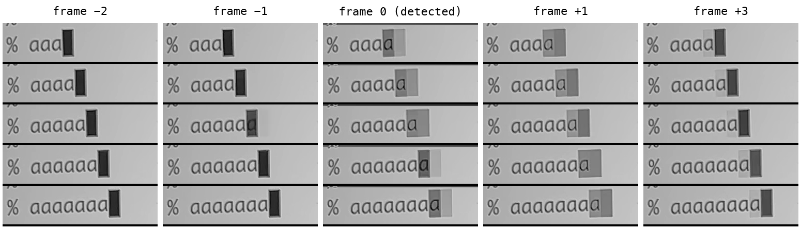

# key-to-photon

Measures how long a terminal takes to show a typed character, from a
slow-motion phone video of typing. The key press is the click in the video's
audio track; the photon is the first frame where the typed line changes.

**Results** for 12 macOS terminals and editors: [results.md](results.md).



*Part of a contact sheet (iTerm2): one row per key press, frames 4.2 ms
apart, frame 0 the first to show the character. In the third row it shows
faintly one frame early, a partial exposure that doesn't count.*

## Recording

- Use the phone's slow-motion mode (iPhone: 240 fps). Exported videos play at
  30 fps with each frame 1/240 s apart in real time; pass `--slowdown` if
  yours differ.
- Put the phone on a tripod, framing the keyboard and the line you type on.
  Record in a quiet room: the clicks are the timing reference.
- Type one character at a time, about a second apart, 10–15 times.
- Exported slow motion starts and ends at normal speed. Measure only the slow
  part with `--range`.
- Make several recordings per terminal, ideally alternating between
  terminals. One recording shows the spread between key presses, not between
  runs.

## Usage

Needs `ffmpeg` and [uv](https://docs.astral.sh/uv/).

```sh
# Save a frame with a 100 px grid to find the typed line. --at is a frame
# number, counting decoded frames from 0 (30 per second of playback).
./ktp.py frame IMG_1234.mov --at 300

# Preview a crop as a green box on the same frame.
./ktp.py frame IMG_1234.mov --at 300 --crop 130,260,880,90

# Measure. --crop is X,Y,W,H around the typed line, with some margin. A
# character later than --max-frames after the click (default 32, 133 ms at
# 240 fps) is missed, and some other change is reported instead.
./ktp.py measure IMG_1234.mov --crop 130,260,880,90 --range 30:4140 --label btmux
```

`measure` prints one row per click and the summary, and writes to `out/`:

- `<label>.json`: every setting, every event (with whether its frame was set
  by hand), and the per-frame changes.
- `<label>-sheet.png`: one row per click, in table order, showing frames −2,
  −1, 0, +1, and +3 around the detected change. Frame 0 is marked by an
  inverted strip at its top.

## Checking the result

Check the contact sheet: in each row, the character should appear in the
marked column and not before. Typical mistakes:

- **A cursor blink picked instead of the character**, when it lands right
  after the click. Set the right frame with `--override CLICK=FRAME`.
- **A sound that wasn't a key press** (a tap, a bump). It shows as "no text
  change", which the summary leaves out, or with a blink picked; leave it out
  with `--skip CLICK`.
- **A quiet click missed.** Lower `--click-ratio`.

## How it works

Times come from the file's own video and audio timestamps, so a late audio
start or uneven frame timing doesn't shift anything.

1. **Clicks.** The audio is split into one bin per video frame, and a bin
   counts as a sound when it is `--click-ratio` times louder than the audio
   around it. Sounds within `--min-gap` frames are one key stroke, press and
   release; the press is the first of them at least half as loud as the
   loudest, since a release can be louder than its press but a finger
   brushing the key beforehand is much quieter.
2. **Onset.** The press starts where its sound does: from the loudest sample,
   back while the envelope stays above the background, across dips shorter
   than half a frame. A key stroke is a burst of several peaks (finger on the
   key, the key bottoming out); this takes the first.
3. **Changes.** For each frame after a click, the crop is aligned to the
   previous frame (±4 px, for camera shake), global brightness steps are
   removed, and the pixels that changed by over `--pixel-threshold` are
   counted.
4. **Text frame.** Frames over `--threshold` changed pixels form runs; the
   strongest run between `--min-frames` and `--max-frames` after the onset
   (and inside `--range`) is the character. It starts at its first frame with
   at least `--onset-fraction` of its peak, so fade-in animations count from
   when they become visible, but camera noise doesn't.
5. **Latency** is the text frame's time minus the onset, in real time.

`--min-frames` (default 1, 4.2 ms at 240 fps) is the shortest latency that
can be reported. It keeps a cursor blink landing on the click from counting.

## Tests

```sh
uv run --with numpy --with pytest pytest
```

They build small clips with ffmpeg, with known click and change times.

## Caveats

- Absolute numbers include offsets that compare recordings only roughly:
  - The onset is the first sound of the key stroke, before the switch fires.
    How much before depends on how you type.
  - The phone's audio/video sync may be off, and may differ between export
    formats. Check it by filming something that makes a sharp sound when it
    visibly hits, such as a pencil tip knocking on a table (see
    [results.md](results.md#audiovideo-sync)).
  - A change shows only in the next camera frame: 0–4.2 ms late, 2.1 ms on
    average.
- A character drawn while the shutter is open shows faintly one frame early.
  If it changes fewer pixels than `--threshold`, or than `--onset-fraction`
  of the peak, the next frame counts: up to one frame per event, equally
  likely for any terminal.
- The total includes the keyboard, the OS, the app, compositing, and the
  display's refresh (8.3 ms at 120 Hz).
- Differences between terminals within one session of recordings are more
  reliable than between sessions.
